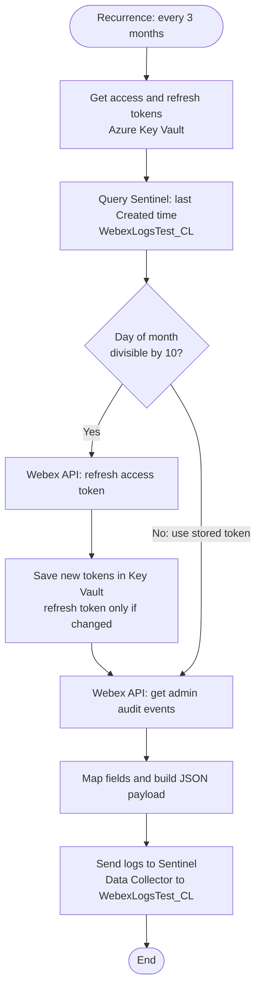

# Webex Audit Logs to Microsoft Sentinel (Logic App)

An Azure Logic App that pulls **Webex Admin Audit Events** through the Webex REST API and ingests them into **Microsoft Sentinel** (Log Analytics) as a custom table, `WebexLogsTest_CL`. OAuth tokens are kept in **Azure Key Vault** and refreshed automatically by the workflow.

---

## Table of Contents

1. [Overview](#overview)
2. [Architecture and Flow](#architecture-and-flow)
3. [Approach](#approach)
4. [Prerequisites](#prerequisites)
5. [Configuration](#configuration)
6. [Deployment](#deployment)
7. [Validation (KQL)](#validation-kql)
8. [Known Limitations and Improvements](#known-limitations-and-improvements)
9. [Security Notes](#security-notes)

---

## Overview

| Item | Value |
|---|---|
| Platform | Azure Logic Apps (Consumption or Standard) |
| Source | Webex Admin Audit Events API (`/v1/adminAudit/events`) |
| Destination | Log Analytics workspace used by Microsoft Sentinel |
| Custom table | `WebexLogsTest_CL` |
| Secrets store | Azure Key Vault (`Webex-AccessToken`, `Webex-RefreshToken`) |
| Auth to Azure | Managed Identity |
| Schedule | Recurrence trigger, every 3 months |

---

## Architecture and Flow



---

## Approach

1. **Trigger**: A `Recurrence` trigger starts the workflow (interval 3, frequency Month).
2. **Read tokens**: `Get-AccessToken` and `Get-RefreshToken` read the current secrets from Key Vault through the Key Vault managed connector.
3. **Find last ingested event**: `Run_query_and_list_results` runs a KQL query against the workspace to get the latest `Created_t` already in `WebexLogsTest_CL`.
4. **Token refresh decision**: A condition checks whether the day of the month is divisible by 10.
   - **Yes**: Call `https://webexapis.com/v1/access_token` with `grant_type=refresh_token`, store the new access token in Key Vault, and store the new refresh token only if Webex returned a different one.
   - **No**: Use the access token already stored in Key Vault.
5. **Fetch audit events**: Call `GET /v1/adminAudit/events` with `orgId`, `from`, `to` and `max=100`.
6. **Transform**: A `Select` action flattens the event JSON (actor, target, event, config, trial, and error fields) into clean column names.
7. **Ingest**: A `Compose` action builds the JSON body and the **Azure Log Analytics Data Collector** connector posts it with `Log-Type: WebexLogsTest_CL`.

---

## Prerequisites

### Webex
- A Webex **Control Hub** organisation and your **Org ID**.
- A Webex **Integration** (OAuth app) with the audit events scope (for example `audit:events_read`). Check the Webex developer docs for the current scope name.
- A full admin account to authorise the integration once and obtain the first **access token** and **refresh token**.

### Azure
- Azure subscription with a **Log Analytics workspace** with Microsoft Sentinel enabled.
- An **Azure Key Vault**.
- A **Logic App** with a **system-assigned managed identity** enabled.
- API connections in the same resource group:
  - `keyvault` (Managed Identity)
  - `azuremonitorlogs` (Azure Monitor Logs)
  - `azureloganalyticsdatacollector` (workspace ID and key)

### Permissions
| Identity | Resource | Role / Permission |
|---|---|---|
| Logic App managed identity | Key Vault | Get and Set on secrets (for example `Key Vault Secrets Officer`) |
| Logic App managed identity / connection | Log Analytics workspace | Log Analytics Reader (for the query) |

---

## Configuration

Replace every placeholder in the workflow JSON before deploying.

| Placeholder | Where it is used | Description |
|---|---|---|
| `<WEBEX_CLIENT_ID>` | Get-New-AccessToken body | Webex integration client ID |
| `<WEBEX_CLIENT_SECRET>` | Get-New-AccessToken body | Webex integration client secret (**store in Key Vault, never in code**) |
| `<WEBEX_ORG_ID>` | Get-AuditLogs URI | Webex organisation ID |
| `<KEYVAULT_NAME>` | Key Vault URIs | Name of your Key Vault |
| `<SUBSCRIPTION_ID>` | Connections and query | Azure subscription ID |
| `<RESOURCE_GROUP>` | Connections and query | Resource group name |
| `<WORKSPACE_NAME>` | Query action | Log Analytics workspace name |

### Key Vault secrets to create
| Secret name | Content |
|---|---|
| `Webex-AccessToken` | Initial Webex access token |
| `Webex-RefreshToken` | Initial Webex refresh token |

---

## Deployment

1. Create the Key Vault and add the two secrets above.
2. Create the Logic App and enable the **system-assigned managed identity**.
3. Grant the managed identity access to Key Vault secrets and the workspace.
4. Create the three API connections (`keyvault`, `azuremonitorlogs`, `azureloganalyticsdatacollector`).
5. Open the Logic App **Code view** and paste the workflow JSON (with placeholders replaced).
6. Run the workflow manually once and check the run history.
7. Confirm data arrives in Sentinel (see below). The custom table can take a few minutes to appear after the first ingestion.

---

## Validation (KQL)

```kql
WebexAuditLogs_CL
| where TimeGenerated > ago(7d)
| project TimeGenerated, Created_t, ActorEmail_s, EventCategory_s, EventDescription_s, ActionText_s
| order by Created_t desc
```

Last ingested event time (the same query the workflow uses):

```kql
WebexAuditLogs_CL
| where TimeGenerated > ago(90d)
| summarize LastCreated = max(Created_t)
```

---

## Known Limitations and Improvements

| Area | Current behaviour | Suggested improvement |
|---|---|---|
| Incremental pull | The `from` date is hardcoded; the `LastCreated` query result is not used | Use `LastCreated` as the `from` value to avoid gaps and duplicates |
| Pagination | `max=100` with no paging | Follow the `Link` header (`rel="next"`) until all events are read |
| Schedule vs token life | Webex access tokens are short-lived (typically days) and refresh tokens last about 90 days; a 3-month schedule is borderline | Run more often (for example daily or hourly) and refresh the token on every run |
| Refresh condition | Refresh only when the day of month is divisible by 10; the condition name `IsDateContainsEight` is misleading | Rename it, or refresh on every run when the token is near expiry |
| Ingestion API | Uses the HTTP Data Collector API | Microsoft has announced its retirement; verify the current status and migrate to the **Logs Ingestion API** with a DCE and DCR |
| Error handling | No retry or alerting on failed runs | Add retry policies and a failure notification (email, Teams, or a Sentinel alert) |
| Duplicates | No de-duplication on `WebexEventId` | De-duplicate in KQL or in an analytics rule |

---

## Security Notes

- **Do not commit secrets.** The Webex `client_secret` must not be stored in the workflow definition. Keep it in Key Vault and read it at runtime. If it has ever been committed or shared, **rotate it**.
- Remove real subscription IDs, org IDs, and tenant details before pushing to a public repository.
- Enable **Secure inputs and outputs** on the Key Vault and token actions so tokens do not appear in run history.
- Use least privilege for the managed identity.

---

## Suggested Repository Structure

```
.
├── README.md
├── logicapp/
│   └── webex-audit-to-sentinel.json   # sanitised workflow definition
├── docs/
│   └── flowchart.html                 # one-page flow diagram
└── kql/
    └── validation.kql
```

---

## License

Add a license of your choice (for example MIT).
